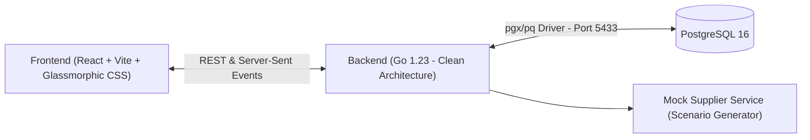

# 🛒 Supplier Catalog Sync & Operations Center

A robust, fault-tolerant Go application with a real-time React dashboard and PostgreSQL storage that synchronizes a retail shop's local catalog with supplier batch feeds.

Built to address out-of-order data arrival, idempotent re-runs, non-destructive interruption recovery, and audit tracking of catalog changes and invalid data.

---

## 🌟 Key Features

1. **Out-of-Order Packet Protection**
   - Updates compare supplier timestamps (`supplier_updated_at`). Older packets arriving late are safely ignored (`SKIPPED_OUTDATED`) and never overwrite newer data.
2. **Withdrawn Product Protection (Tombstone Pattern)**
   - Products withdrawn from sale are marked with a withdrawal timestamp. Out-of-order packets with active status arriving after a withdrawal **cannot resurrect** the product.
3. **Strict Idempotency & Deduplication**
   - Re-importing identical batches produces zero duplicate records and zero unintended state transitions (`SKIPPED_IDENTICAL`).
4. **Failure Resiliency & Checkpointed Resume**
   - Batches are processed inside isolated database transactions (`BEGIN` ... `COMMIT`).
   - If an application crash, network outage, or container shutdown occurs mid-sync, the job transitions to `INTERRUPTED`.
   - Staff can click **"Resume"** to pick up from the exact incomplete batch without re-processing already committed work.
   - **Partially completed updates are never marked as complete.**
5. **"What Changed" Audit Trail**
   - Granular changelog tracking every creation, price update, description update, and withdrawal with a visual side-by-side field diff viewer.
6. **"Problems Needing Attention" Center**
   - Catches corrupted or invalid items (e.g. negative prices, missing SKUs) and flags them for staff review and manual resolution without aborting the entire batch.

---

## 🛠️ Architecture & Tech Stack



- **Backend**: Go 1.23, `net/http` + Chi Router, PostgreSQL driver `github.com/lib/pq`, Server-Sent Events (SSE) hub.
- **Frontend**: React 18, Vite, Lucide Icons, Vanilla CSS Design System with dark mode, glassmorphism, and responsive tables.
- **Database**: PostgreSQL 16 (running on container port `5432`, mapped to host port `5433` to prevent port collisions).
- **Deployment**: Multi-stage Dockerfiles and Docker Compose.

---

## 🚀 Quick Start (Running Locally)

### Prerequisites
- Docker & Docker Compose installed.

### 1-Step Launch
From the project root:
```bash
docker compose up --build -d
```

### Access URLs
- **Staff Dashboard (Web UI)**: [http://localhost:3000](http://localhost:3000)
- **Backend API**: [http://localhost:8080](http://localhost:8080)
- **Health Check**: [http://localhost:8080/health](http://localhost:8080/health)
- **PostgreSQL Database**: `localhost:5433` (`user: postgres`, `password: postgres`, `db: catalog_db`)

---

## 🧪 Running Automated Tests

Run the domain unit tests inside the Go Docker container:
```bash
docker run --rm -v "${PWD}/backend:/app" -w /app golang:1.23-alpine go test -v ./...
```
*(On Windows PowerShell, use `${PWD}` or `$(Get-Location)`)*

### Test Coverage Highlights:
- `TestConflictResolver_NewProduct`: Validates clean initial insertion.
- `TestConflictResolver_OlderInformationMustNotReplaceNewer`: Verifies out-of-order timestamp rejection.
- `TestConflictResolver_OlderInformationMustNotRestoreWithdrawnProduct`: Verifies tombstone protection against stale packets.
- `TestConflictResolver_IdempotencyRepeatedImport`: Verifies identical re-imports produce no duplicates.
- `TestConflictResolver_ValidationRejectsCorruptItem`: Verifies missing SKU and negative prices are caught.

---

## 🎥 3–5 Minute Demo Walkthrough Script

When demonstrating the application or recording your video:

1. **Dashboard Overview**:
   - Open `http://localhost:3000`. Point out the header status (`Ready / Idle`), action buttons, metrics cards, and three tabs (*What Changed*, *Problems Needing Attention*, *Current Catalog*).
2. **Initial Sync & Real-Time Progress**:
   - Click **"Start Update"**. Watch the animated progress bar update in real time via Server-Sent Events (SSE) as batches 0 through 5 commit.
3. **Verify "What Changed"**:
   - Switch to the **What Changed** tab. Show the recorded creations, updates, and withdrawals.
   - Click **"View Diff"** on `SKU-HEADPHONE-01` to show the price drop from `$199.00` to `$179.00`.
4. **Demonstrate Idempotency**:
   - Click **"Run Sync Again (Test Idempotency)"**.
   - Show the metrics: **0 New Products**, **0 Details Changed**, **15 Skipped**! Proves importing twice is non-destructive and creates zero duplicates.
5. **Demonstrate Interruption & Resume**:
   - Click **"Reset Demo"** in the top right to start clean.
   - Click **"Start Update"**, then immediately click **"Simulate Outage / Crash"** (or stop the container via `docker stop catalog-backend`).
   - Notice the status updates to **`INTERRUPTED`** with warning badge. The progress bar reflects the incomplete state (e.g. `1/6 Batches Committed`).
   - Click **"Resume Interrupted Sync"**. Notice it picks up immediately from Batch 2 without re-doing Batch 0 or 1, and runs to `COMPLETED`!
6. **Demonstrate Problems Needing Attention**:
   - Switch to the **Problems Still Needing Attention** tab.
   - Show `SKU-MONITOR-07` with negative price and the missing SKU item. Inspect their raw JSON supplier payloads.
   - Click **"Mark Resolved"** to resolve an issue.
7. **Browse Current Catalog**:
   - Switch to the **Current Catalog** tab. Search for `"headphone"`, filter by `Withdrawn`, and inspect the supplier timestamps.

---

## 📌 Assumptions

1. **Supplier Timestamps**: Each supplier product entry includes an `updated_at` ISO8601 timestamp representing the canonical version timestamp at the supplier.
2. **SKU as Primary Key**: SKUs are unique business identifiers for products.
3. **Monetary Precision**: All prices are modeled as 64-bit integer cents (`price_cents`) to prevent floating-point rounding errors.
4. **Batch-Level Transactionality**: Committing transactions per batch provides the optimal trade-off between atomic durability and high throughput without holding database locks indefinitely.
5. **Tombstone Semantics**: A product can only be reinstated if a supplier sends a legitimate update with `is_withdrawn: false` whose timestamp is strictly newer than the recorded `withdrawn_at` timestamp.

---

## 🚧 Unfinished Work & Future Improvements

- **Supplier Outage Exponential Backoff**: Implement automated client-side retry with jitter when connecting to remote HTTP vendor endpoints.
- **Manual Conflict Override UI**: Allow staff to view a side-by-side conflict and force-apply an older patch if business circumstances require it.
- **Authentication & Multi-Tenant Support**: Add JWT/OAuth2 session auth and partition catalogs by `supplier_id` for shops with hundreds of distinct vendors.
- **WebSocket Bi-Directional Chat/Notification**: In addition to SSE, provide bi-directional alerts for multi-user coordination.

---

## 🤖 AI Tools Disclosure

In accordance with the submission guidelines:
- **Planning & Architecture**: AI was used to draft the initial system plan, review edge cases for tombstone protection, and design the transactional batch checkpoint state machine.
- **Boilerplate & CSS Styling**: AI assisted in scaffolding the initial Chi HTTP routes and creating the custom Glassmorphic Vanilla CSS tokens.
- **Verification**: All core synchronization logic, version comparison algorithms, out-of-order rejection rules, and SQL migrations were manually reviewed, tested, and validated with automated test suites.
